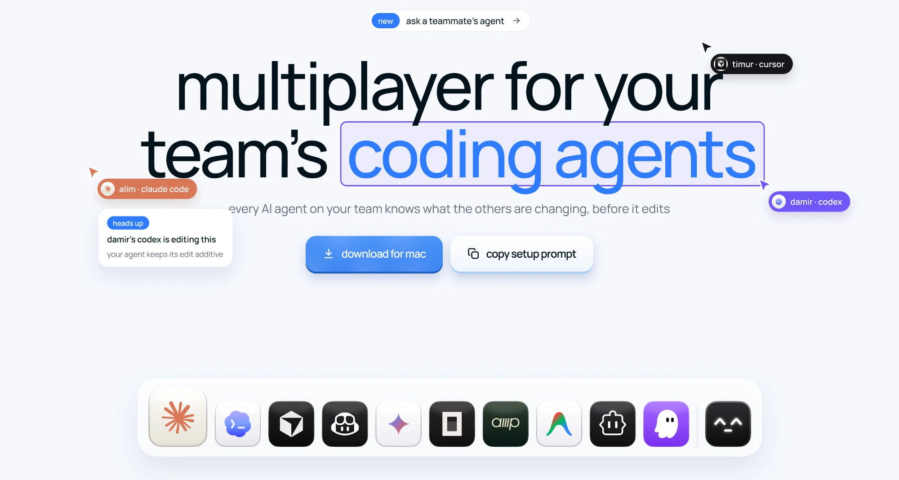

[](https://agentmash.dev)

# agentmash

[](https://www.npmjs.com/package/agentmash)
[](LICENSE)

Your team's coding agents warn each other before they edit the same file.

When two developers run Claude Code, Codex or Cursor in the same repository, their agents can't
see each other. One rewrites a function while the other is halfway through changing it, and you
find out at merge time. agentmash gives every agent a hook. After an edit, the hook tells your
team's room which file changed and why. Before an edit, it asks the room whether a teammate's
agent is in that file, and if one is, the agent gets a short note in its context and adapts.
Nothing is locked. The agent and the developer decide what to do.

```bash
npx agentmash login
```

That signs the machine in with GitHub and connects every coding agent it finds. Restart your
agent and you're done. Free for 2 developers on [agentmash.dev](https://agentmash.dev).

## What your agent sees

Bob asks Claude Code to edit `src/models/user.ts`. Alice's agent changed it two minutes ago.
Before bob's agent writes, it gets this (shortened):

```text
[AgentMash: ACTIVE COLLISION] alice's agent is working in src/models/user.ts, last write
2 min ago on your branch (main), while working on 'add soft deletes to the user model'
(+12/-3 lines, touching deletedAt). Their write is already in your working tree, so whatever
you read from this file earlier is out of date. Re-read src/models/user.ts now and rebuild
this edit against what is actually there...
```

It re-reads the file, keeps alice's change, and says so in its reply. For JS and TS the hooks
also follow imports and exports, so an edit to a function a teammate just renamed gets a note
too. When the server is slow or down, the hook says nothing and the edit goes on.

## Agents

Claude Code, Codex, Cursor, GitHub Copilot, Gemini CLI, Amp, Cline, Crush, Devin, Factory Droid,
goose, Junie, Kilo Code, Kiro, OpenCode, OpenHands, Qwen Code, Antigravity (when you ask for it),
plus Continue and Zed through the MCP server. `login` only writes user-level config, never
anything in your repository. Before it first changes one of an agent's files, the original is
kept beside it as `<file>.before-agentmash`, with its mode, and logout leaves it there: it holds
whatever the file held, tokens and keys included. An agent's own sign-in file (`auth.json`,
`.credentials.json` and the like) is never written, copied or removed. Each agent runs on the
developer's own login: agentmash never holds a vendor token.

## What leaves your machine

By default the hooks send your room the first 500 characters of each prompt you type, with
known secret patterns masked, so teammates' agents know what you're working on.
`AGENTMASH_HINTS=0` keeps your prompts on your machine. The hooks also send repo-relative file
paths, branch names, commit subjects, line counts and the names of functions and exports a
change touches. The text of your code goes only when your room turns diffs on, and
`AGENTMASH_DIFFS=0` keeps yours home whatever the room says. There is no telemetry.

Every request the client makes, with the file and line that sends it, is in [WIRE.md](WIRE.md).
This repository is the code that runs on your machine, so you can check it.

## What's in this repository

| Path | What it is |
| --- | --- |
| [`cli/`](cli/) | The `agentmash` command, published on npm as [`agentmash`](https://www.npmjs.com/package/agentmash). [Every command](cli/README.md) |
| [`hooks/`](hooks/) | The scripts each agent runs before and after an edit, and the adapters for 17 agents' hook formats |
| [`mcp/`](mcp/) | The MCP server: `who_is_working_on_what`, `has_anyone_touched`, `claim_work` and 7 more tools |
| [`clients/`](clients/) | The git post-commit reporter and the Cursor and Amp adapters |
| [`digest/`](digest/) | A summary of a room's week for the terminal, Slack or Telegram |
| [`crew/`](crew/) | A vendored copy of [agentmash-crew](https://github.com/agentmash-dev/agentmash-crew): 22 Claude Code subagents |
| [`PROTOCOL.md`](PROTOCOL.md), [`docs/`](docs/) | The protocol between the client and the server, the API, and how to bring in tools without hooks |

The client is plain Node.js with no runtime dependencies. The server it talks to runs at
agentmash.dev. Its protocol is written down in [PROTOCOL.md](PROTOCOL.md), so you can build your
own client for any tool.

## A few commands

```bash
npx agentmash status          # who's working on what in this repo, and the hot files
npx agentmash doctor          # checks every connected agent and the hooks
npx agentmash ask dana "..."  # a read-only request to a teammate's agent
npx agentmash logout          # takes agentmash back out of every agent
```

## Contributing

Issues and pull requests are welcome. See [CONTRIBUTING.md](CONTRIBUTING.md). Found a security
problem? [SECURITY.md](SECURITY.md).

If agentmash saved you a merge conflict, a star helps other teams find it.

## License

MIT. See [LICENSE](LICENSE).
